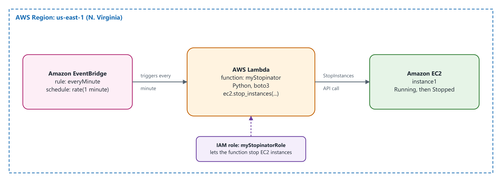
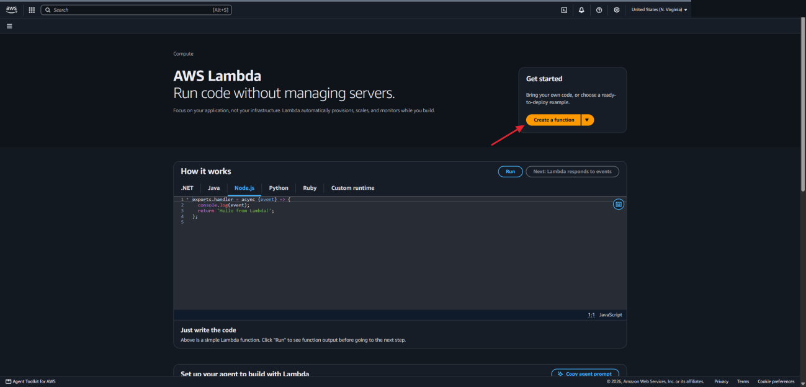
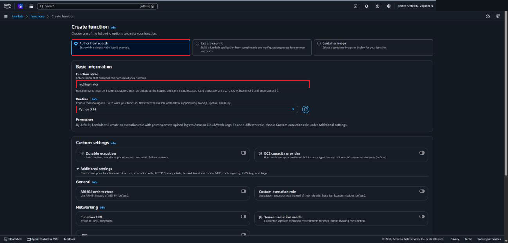
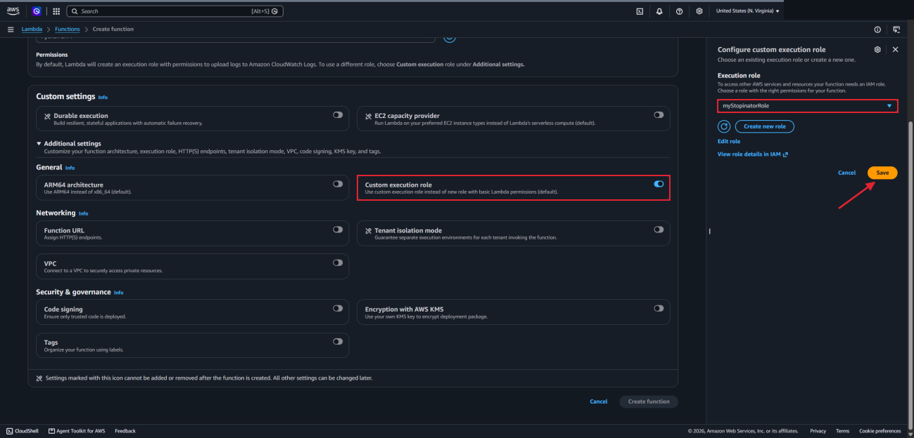
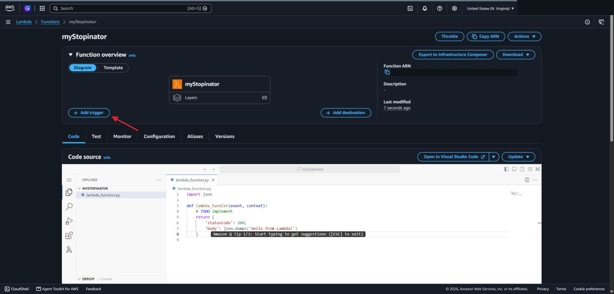
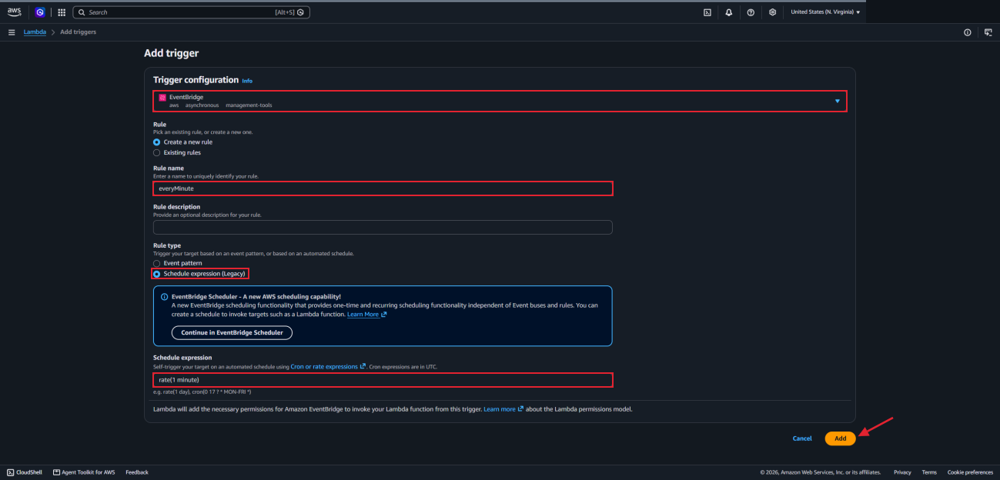
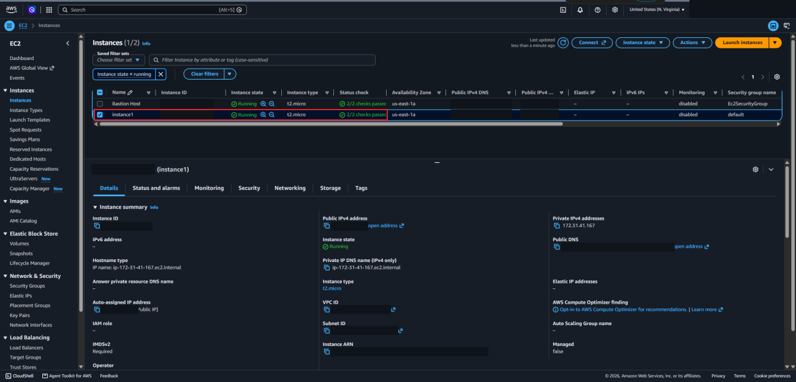
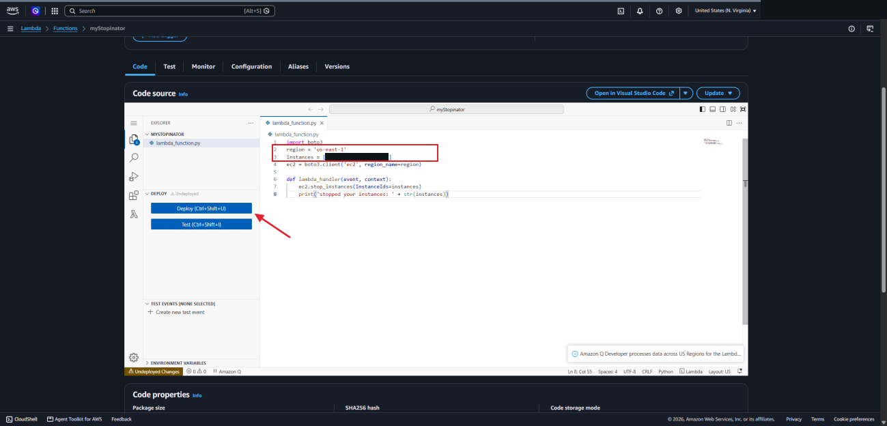
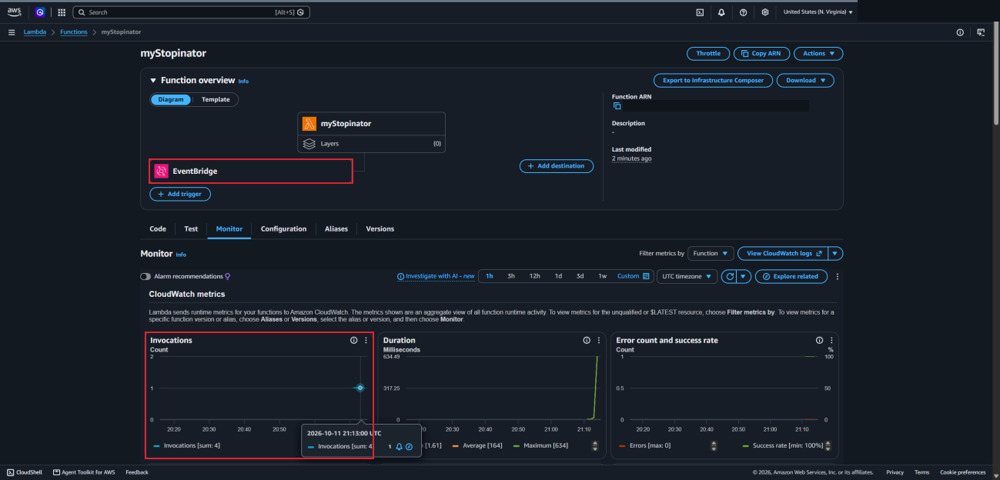
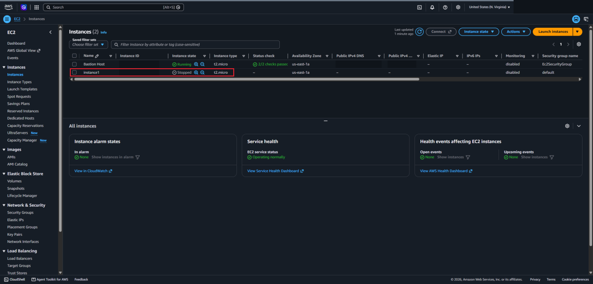

# Lab 4 — AWS Lambda: Stopping an EC2 Instance on a Schedule

## Overview

This lab was about **AWS Lambda**, which runs code without me having to manage a server. I created a Lambda function called `myStopinator` and gave it an existing IAM role that allows it to stop EC2 instances. Then I added an **Amazon EventBridge** rule that triggers the function every minute, and pasted in a few lines of Python that stop one specific instance.

To check that it worked, I went back to the EC2 console and saw that `instance1` had gone from Running to Stopped without me touching it.

## Objectives

- Create a Lambda function that uses an existing IAM role
- Configure an EventBridge schedule as the trigger
- Update the function code with my Region and instance ID, then deploy it
- Verify that the function stopped the EC2 instance

## Tools & Technologies

| Category | Tools |
|---|---|
| Cloud platform | Amazon Web Services (AWS) |
| Services | AWS Lambda, Amazon EventBridge, Amazon EC2, IAM, Amazon CloudWatch |
| Objects | Lambda function, execution role, EventBridge rule, EC2 instance |
| Language | Python (boto3) |
| Region | US East (N. Virginia) `us-east-1` |

## Architecture



---

## Task 1 — Create the Lambda Function

### 1.1 Open Lambda

I searched for **Lambda** in the console and chose **Create a function**.



### 1.2 Basic information

| Setting | Value |
|---|---|
| Option | Author from scratch |
| Function name | `myStopinator` |
| Runtime | Python (the instructions said 3.11; my screenshot shows 3.14 selected) |



### 1.3 Execution role

By default Lambda creates a new role that can only write logs. This function needs to stop an EC2 instance, so under **Additional settings** I turned on **Custom execution role** and picked the existing role **myStopinatorRole**. The role is what gives the function permission to act on other AWS services.



Then I chose **Create function**.

---

## Task 2 — Configure the Trigger

A trigger is what makes the function run. Here it is a schedule, so the function works like a cron job on a Linux server or a scheduled task on Windows, except there is no server to keep running.

On the function page I chose **Add trigger**.



| Setting | Value |
|---|---|
| Trigger | EventBridge (CloudWatch Events) |
| Rule | Create a new rule |
| Rule name | `everyMinute` |
| Rule type | Schedule expression |
| Schedule expression | `rate(1 minute)` |



A real schedule would more likely use a cron expression, like stopping instances at the end of the work day. A one-minute rate is used here so the result shows up quickly.

---

## Task 3 — Configure the Function Code

### 3.1 Find the instance ID

The code needs the ID of the instance to stop. In another browser tab I opened **EC2 → Instances**, confirmed that **instance1** was running, and copied its instance ID.



### 3.2 Paste and edit the code

Back in Lambda, on the **Code** tab, I opened `lambda_function.py`, deleted the sample code, and pasted this in:

```python
import boto3
region = '<REPLACE_WITH_REGION>'
instances = ['<REPLACE_WITH_INSTANCE_ID>']
ec2 = boto3.client('ec2', region_name=region)

def lambda_handler(event, context):
    ec2.stop_instances(InstanceIds=instances)
    print('stopped your instances: ' + str(instances))
```

I replaced the two placeholders with `us-east-1` and the instance ID I copied, keeping the single quotation marks around each one. Then I chose **Deploy**.



What the code does:

- `boto3` is the AWS library for Python. `boto3.client('ec2', ...)` creates a connection to the EC2 service in my Region.
- `lambda_handler` is the function Lambda runs each time it is triggered.
- `ec2.stop_instances(...)` tells EC2 to stop every instance in the list.

### 3.3 Monitor

The **Monitor** tab shows CloudWatch metrics for the function. The **Invocations** chart counted how many times the function had run, and the error chart showed 0 errors with a 100% success rate. The EventBridge trigger also shows up in the function overview.



---

## Task 4 — Verify That It Worked

I went back to the EC2 console tab and refreshed. **instance1** was now **Stopped**.



If I started the instance again, it would be stopped again within a minute, because the rule keeps triggering the function every minute.

---

## What I Learned

- Lambda runs code in response to a trigger, and I never set up or signed in to a server for it
- A Lambda function can only do what its execution role allows. Without **myStopinatorRole** it could not have stopped the instance.
- EventBridge can run a function on a schedule with a rate or cron expression, the same idea as a cron job
- A few lines of Python with boto3 are enough to control another AWS service
- Changes to the code don't take effect until the function is deployed
- The Monitor tab is where to check how often the function ran and whether it had errors
- A schedule like this keeps running, so the instance gets stopped again every time it is started

---

> **Note:** Screenshots are from a temporary AWS lab account. The AWS account ID, my lab session username, the function and instance ARNs, the public IP addresses and public DNS names, and the IDs of the instances, VPC, and subnet have been redacted. The architecture diagram is my own drawing. The environment was shut down after I finished.

[← Back to AWS Labs](../)
