# Lab 5 — AWS Elastic Beanstalk: Deploying a Web App

## Overview

This lab was about **AWS Elastic Beanstalk**, a service that runs a web application for me and builds the AWS resources it needs. The lab account already had an Elastic Beanstalk environment set up, but with no code on it. I uploaded a sample application, watched the environment deploy it, and then went looking for the resources Elastic Beanstalk had created behind the scenes.

What I noticed most is how little I had to do. I uploaded one zip file, and the EC2 instances, load balancer, Auto Scaling group, and security group were already there.

## Objectives

- Open the existing Elastic Beanstalk environment and check its health
- Deploy a sample application to it
- Look at the environment's configuration and monitoring
- Find the AWS resources that support the application

## Tools & Technologies

| Category | Tools |
|---|---|
| Cloud platform | Amazon Web Services (AWS) |
| Services | AWS Elastic Beanstalk, Amazon EC2, Elastic Load Balancing, Amazon EC2 Auto Scaling, Amazon CloudWatch |
| Platform | Tomcat 9 with Corretto 11 on 64bit Amazon Linux 2023 |
| Region | US East (N. Virginia) `us-east-1` |

## Architecture

This is what the environment looked like once I explored it in Task 3.

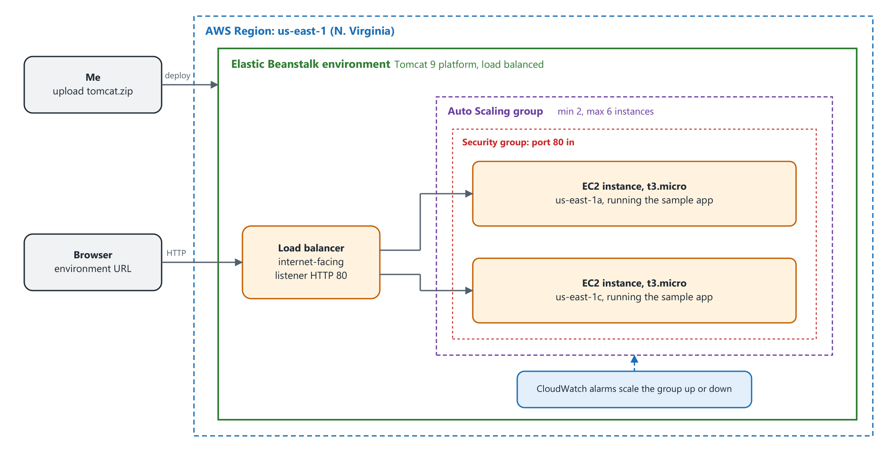

---

## Task 1 — Access the Elastic Beanstalk Environment

### 1.1 Environments

I searched for **Elastic Beanstalk** in the console. The **Environments** page listed one environment with a health of **Ok**, running the Tomcat platform.

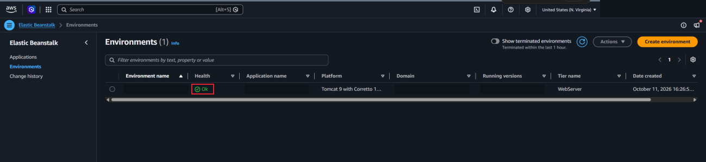

### 1.2 Environment dashboard

Choosing the environment name opens its dashboard. Health was **Ok**, so the environment was ready to host an application, but it had no code running yet.

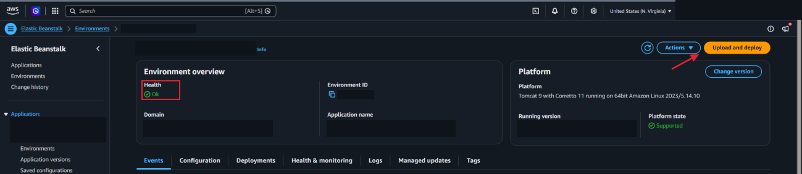

### 1.3 Test the URL

I chose the **Domain** link, which ends in `elasticbeanstalk.com`. It opened a new tab with **HTTP Status 404 – Not Found**. That is expected, because the application server was running with no application on it.

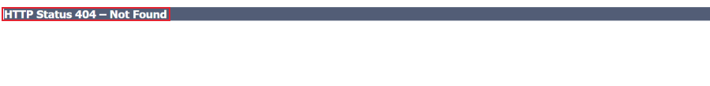

---

## Task 2 — Deploy a Sample Application

### 2.1 Upload and deploy

I downloaded the sample application, `tomcat.zip`, from the AWS documentation. On the dashboard I chose **Upload and deploy**, picked the file, and chose **Deploy**.

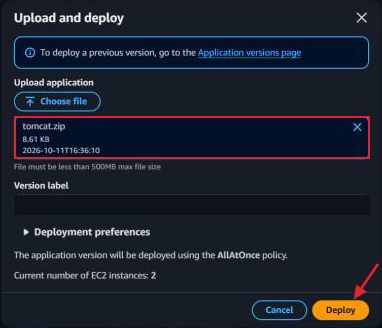

### 2.2 Deployment finished

After a minute or two the banner said **Environment update successfully completed**. The events list shows each step, including "New application version was deployed to running EC2 instances."

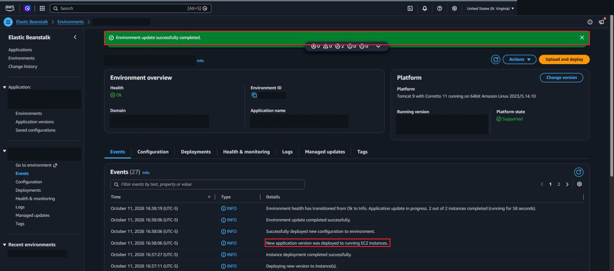

### 2.3 The app is live

I went back to the tab with the 404 and refreshed. The sample application loaded.

### 2.4 Configuration

**Configuration** in the left pane shows how the environment is set up. Under **Infrastructure**:

| Setting | Value |
|---|---|
| Environment type | Load balanced |
| Min instances | 2 |
| Max instances | 6 |
| Scaling metric | NetworkOut |
| Instance types | `t3.micro`, `t3.small` |

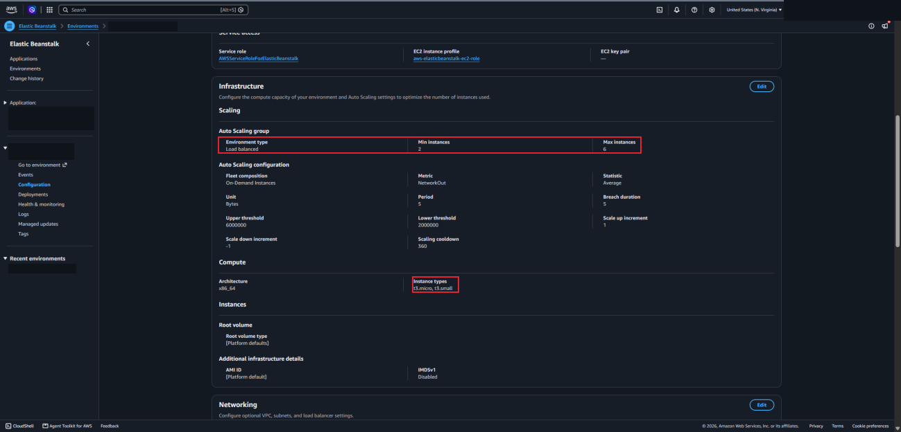

The environment doesn't include a database, but the configuration page has an option to add one.

### 2.5 Monitoring

**Health & monitoring** shows both instances with a status of **Ok**, plus charts for CPU utilization and network traffic.

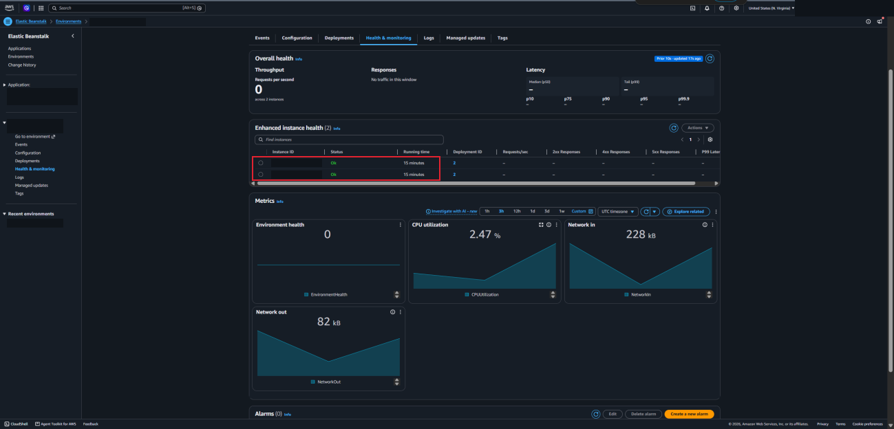

---

## Task 3 — Explore the Resources Behind the Application

Elastic Beanstalk created these resources, but I can still open each one in the EC2 console.

### 3.1 EC2 instances

**EC2 → Instances** showed two running `t3.micro` instances, one in `us-east-1c` and one in `us-east-1a`. These are the servers hosting the web app.

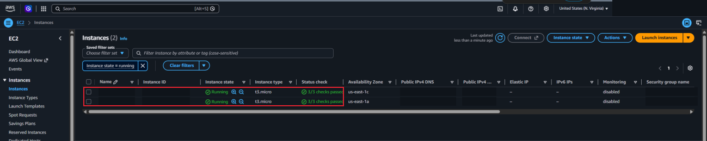

### 3.2 Security group

On an instance's **Security** tab, the security group has one inbound rule: TCP port **80**. The source is another security group, not the whole internet.

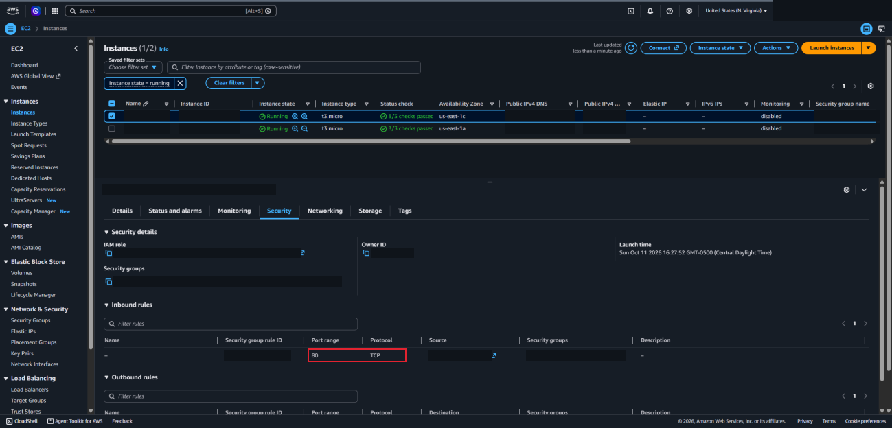

### 3.3 Load balancer

**Load Balancers** showed an internet-facing load balancer with **2 of 2 instances in service**. Its listener takes HTTP on port 80 and forwards it to port 80 on the instances.

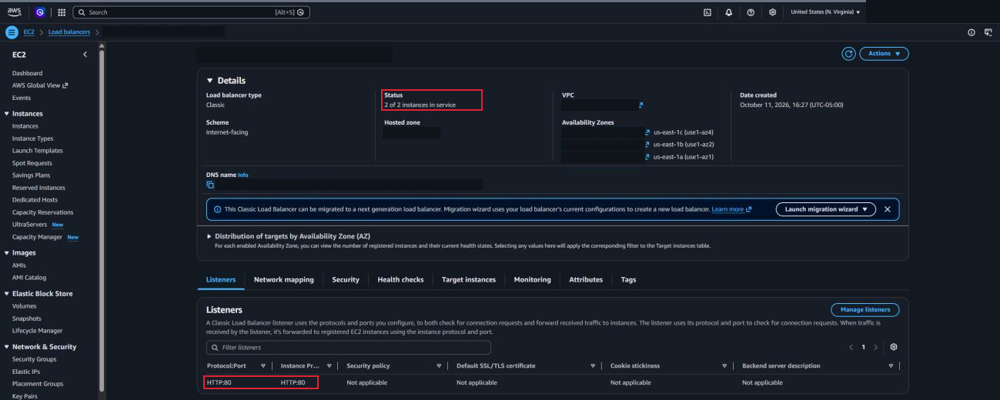

### 3.4 Auto Scaling group

**Auto Scaling Groups** showed a desired capacity of **2** and scaling limits of **2 - 6**. This matches the min and max I saw in the Elastic Beanstalk configuration.

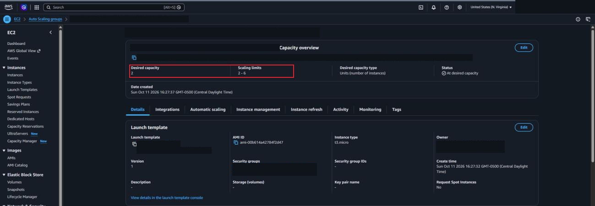

---

## What I Learned

- Elastic Beanstalk lets me deploy an application by uploading the code. I didn't launch or configure any servers myself.
- An environment can be healthy and still return a 404 if no application has been deployed to it
- Behind one environment there are several services working together: EC2 instances, a load balancer, an Auto Scaling group, a security group, and CloudWatch alarms
- The load balancer spreads requests across the instances, and the Auto Scaling group keeps the number of instances between a minimum and a maximum
- Putting the instances in different Availability Zones means the app doesn't depend on one zone
- The resources Elastic Beanstalk creates are normal AWS resources, so I can still open them in the EC2 console

---

> **Note:** Screenshots are from a temporary AWS lab account. The AWS account ID, my lab session username, the environment and application names, the environment URL, public IP addresses and DNS names, ARNs, and the IDs of the instances, security groups, VPC, subnets, load balancer, and launch template have been redacted. The architecture diagram is my own drawing. The environment was shut down after I finished.

[← Back to AWS Labs](../)
